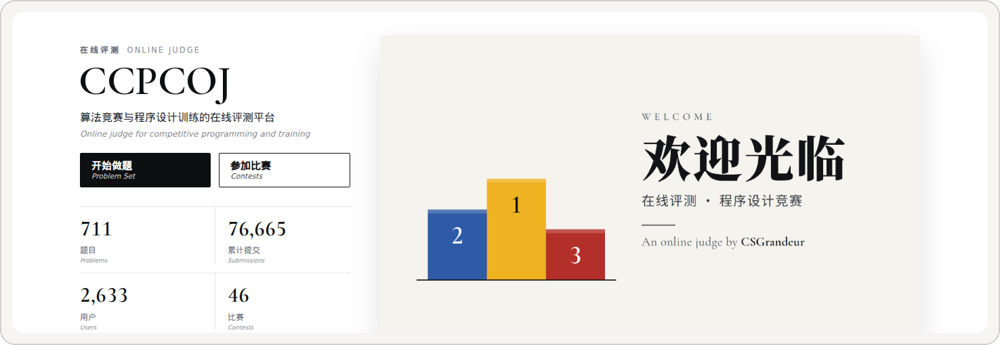

  

建比赛、放题目、生成账号、抽机位、打印、气球、榜单和滚榜

  
  
  
  

  <a href="#开始">开始</a>
  &nbsp;&nbsp;·&nbsp;&nbsp;
  <a href="doc/deploy_doc.md">部署</a>
  &nbsp;&nbsp;·&nbsp;&nbsp;
  <a href="doc/user_doc.md">办赛</a>
  &nbsp;&nbsp;·&nbsp;&nbsp;
  <a href="https://github.com/SZTU-ACM/CCPCOJ-2/releases/latest">下载</a>

 

CCPCOJ 用来办 ICPC / CCPC 标准赛。一场比赛从建赛、题目、队伍账号和机位，做到现场的打印、气球、大屏和直播，再收到闭幕滚榜。

本仓库是使用说明和部署程序。站点以安装包发布，这里没有源码。部署程序只提供 Linux x86_64。

  

运行中的比赛站

## 开始

1. 从 [Releases](https://github.com/SZTU-ACM/CCPCOJ-2/releases/latest) 下载 `csgoj-deploy_<版本>_linux_amd64`。
2. 按 [部署](doc/deploy_doc.md) 装好 Web。在「评测机管理」里复制命令，再装评测机。
3. 按 [办赛](doc/user_doc.md) 建一场标准赛。比赛大类选标准赛，子类型选 ICPC 或 CCPC。

## 从赛前到闭幕

| 赛前 | 赛中 | 赛后 |
| --- | --- | --- |
| 题目、账号、密码条、机位 | 打印、气球、榜单、直播 | 获奖名单、滚榜、离线包 |

正式赛前把这三列各走一遍。步骤和检查清单在 [办赛](doc/user_doc.md)。
