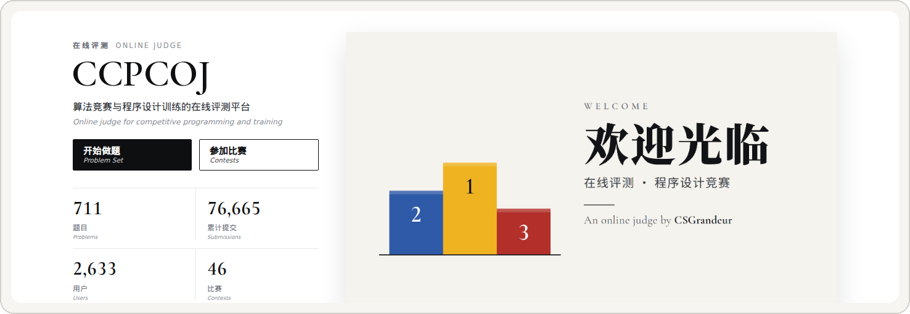

  

建比赛、放题目、生成账号、抽机位、打印、气球、榜单、直播与滚榜

  
  
  
  

  <a href="#开始">开始</a>
  &nbsp;&nbsp;·&nbsp;&nbsp;
  <a href="doc/deploy_doc.md">部署</a>
  &nbsp;&nbsp;·&nbsp;&nbsp;
  <a href="doc/user_doc.md">办赛</a>
  &nbsp;&nbsp;·&nbsp;&nbsp;
  <a href="https://github.com/SZTU-ACM/CCPCOJ-2/releases/latest">下载</a>

 

CCPCOJ 是一套面向 ICPC 与 CCPC 线下及线上标准程序设计竞赛的评测与赛务系统，覆盖从赛前建赛命题、账号机位筹备，到赛中打印气球、大屏榜单、直播推流、主从容灾与对外接口，再到赛后算奖编排与闭幕式滚榜的全流程工作。

部署工具提供 Linux x86_64 版本。先按照部署说明安装 Web 与评测容器，再参照办赛文档筹备标准赛。

  

运行中的比赛站

## 开始

1. 从 [Releases](https://github.com/SZTU-ACM/CCPCOJ-2/releases/latest) 下载 `csgoj-deploy_<版本>_linux_amd64`。
2. 按 [部署](doc/deploy_doc.md) 安装 Web 站点；登录站点初始化系统后，在「评测机管理」页面复制命令，在评测电脑上部署评测容器。
3. 按 [办赛](doc/user_doc.md) 创建比赛：比赛大类选**标准赛**，子类型选 **ICPC** 或 **CCPC**。

## 从赛前到闭幕

| 阶段 | 包含功能 |
| --- | --- |
| 赛前筹备 | 标准赛（ICPC / CCPC）与计奖规则、五类评测（标准 / 特判 / 交互 / 通信 / 多进程）与本机调试工具、Polygon 等题包多包转换调序、题册排版打印 PDF、机位抽签、队伍账号与密码条、赛务账号、客户端 IP 统计补录与收集模式、命令行交题与打印（`csgsubmit` / `printfile`）预置 |
| 赛中运维 | 队伍状态管理与单队延时、代码打印（Lodop / CSGPrint、彩色黑白样式与示例页）、气球队列与气球总览（小票预览、示例小票、气球乱序、封榜自动停）、四主题实时榜单与多维正则筛选、独立外榜推送、九场景直播控制台与单机遥控、主从实时备份与一键转正、CCPC Contest API 与 ICPC CCS API 试调对接 |
| 赛后闭幕 | 获奖名单核对与导出、颁奖编排（8 套典礼主题、背景避让区、全屏投屏、内嵌字库离线 HTML 与可编辑 PowerPoint 导出）、经典滚榜与三维 CG 大屏滚榜（含双击防误触、即时撤回与快速跳奖区）、队伍照片管理与双模式离线滚榜包 |

正式开赛前建议将上表三阶段至少完整预演一遍，确认流程和核对细节可查阅 [办赛](doc/user_doc.md)。
