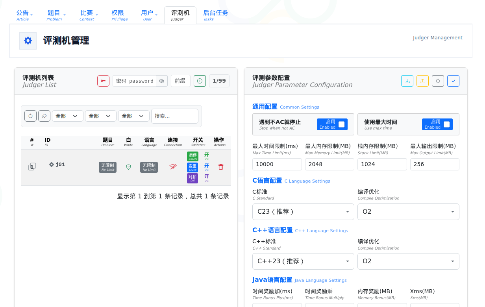

# 部署

用 `csgoj-deploy` 装比赛站。先装 Web，在网页里创建评测机账号，再装评测机。Web 和评测机可以在同一台机器，也可以分开。

命令在 Linux 终端执行。下面的 `mycpc`、端口和口令换成你自己的。

## 1. 准备机器

| 项目 | 要求 |
| --- | --- |
| 系统 | Ubuntu 22.04 / 24.04 / 26.04（x86_64） |
| 内核 | 评测机需要 5.19 以上。Ubuntu 24.04 起已满足 |
| CPU / 内存 | 每个评测机 4 核 4GB。单机试用从 4 核 8GB 起。正式比赛按评测机数量配机器 |
| 网络 | 机器要能上网。评测机要能打开 Web 的地址和端口 |

Ubuntu 22.04 如果内核低于 5.19，先升级再装评测机：

```bash
sudo apt-get update
sudo apt-get install -y linux-generic-hwe-22.04
sudo reboot
```

## 2. 安装 Docker

```bash
sudo apt-get update
sudo apt-get install -y docker.io
sudo systemctl enable --now docker
sudo docker info
```

`docker info` 能打出信息即可。下文命令都加 `sudo`。不想每次加，执行 `sudo usermod -aG docker $USER` 后重新登录。

## 3. 下载部署工具

到本仓库 [Releases](https://github.com/SZTU-ACM/CCPCOJ-2/releases) 下载 Linux x86_64 的 `csgoj-deploy`：

```bash
mkdir -p ~/csgoj && cd ~/csgoj
# <版本号> 用 Releases 页面上的版本，例如 2.0.268
wget -O csgoj-deploy https://github.com/SZTU-ACM/CCPCOJ-2/releases/download/<版本号>/csgoj-deploy_<版本号>_linux_amd64
chmod +x csgoj-deploy
./csgoj-deploy version
```

下不到时，在别的电脑下载，再用 `scp` 传到服务器。

## 4. 部署 Web

```bash
cd ~/csgoj
sudo ./csgoj-deploy up --noninteractive \
    --path-data /csgoj_data \
    --nginx-ranges 20000-20099 \
    --site mycpc:20080:cpcsys:cpc \
    --port-myadmin 20050 \
    --port-db 0 \
    --sql-root '<MySQL-root-口令>' \
    --sql-user-pass '<MySQL-业务口令>' \
    --myadmin-pass '<phpMyAdmin-页面口令>' \
    --csgoj-version <版本号>
```

`<版本号>` 与第 3 节下载的部署工具相同。评测机也填这一个版本。

| 参数 | 填写 |
| --- | --- |
| `--path-data` | 数据目录，写绝对路径。备份这个目录 |
| `--nginx-ranges` | 对外开放的端口范围。站点端口和 phpMyAdmin 端口要落在里面 |
| `--site` | `名称:端口:cpcsys:cpc`。名称只用字母和数字。后两个词照抄 |
| `--port-myadmin` | phpMyAdmin 端口 |
| `--port-db` | 填 `0` |
| `--sql-root` / `--sql-user-pass` / `--myadmin-pass` | 三个口令都自己设，只用字母和数字 |
| `--csgoj-version` | 第 3 节的版本号 |

第一次执行要下载，时间看网络。完成后打开：

```text
http://<服务器IP或域名>:20080
```

打不开时，到云服务器安全组放行这个端口。页面没有样式或图标时，等一分钟再刷新。

### 4.1 网页里接着做

1. 设置系统管理员账号和口令。用户名 5–20 位字母、数字或下划线。点「初始化系统」，在提示框点「确定」。
2. 页面进入「评测机管理」。之后也可以从管理后台 → 评测机进入。在「评测机列表」上方填好评测机口令和账号前缀，点旁边的添加按钮。



## 5. 部署评测机

在「评测机管理」里，双击该评测机那一行的连接状态图标。也可以单击图标打开登录日志，再点「复制部署命令」。剪贴板里是类似这样的命令：

```bash
sudo ./csgoj-deploy judge \
    --server-url http://<Web服务器IP或域名>:20080 \
    --username <评测机账号> \
    --password '<评测机口令>' \
    --oj-name <评测机账号> \
    --pods 1 \
    --csgoj-version <版本号>
```

到评测机所在的机器上，进入放 `csgoj-deploy` 的目录，例如 `~/csgoj`，粘贴执行。

- `--server-url` 用评测机能打开的地址。复制出来如果是 `localhost` 或 `127.0.0.1`，改成服务器的 IP 或域名。
- `--csgoj-version` 与 Web 相同。复制出来的命令里没有这一项时，自己补上。
- `--pods` 是评测机个数，每个要 4 核 4GB。机器不够时，命令会写出最多能开几个。内存不到 4GB 时，换一台机器装评测机。

回到「评测机管理」，状态变为在线即可。

## 6. 检查是否装好

```bash
sudo docker ps
```

应能看到 `db`、`csgoj-redis`、`myadmin`、`nginx-server`、`php-mycpc`，以及 `judge-<名称>`。多个评测机时是 `judge-<名称>-1`、`judge-<名称>-2`。站点名称不是 `mycpc` 时，把 `php-mycpc` 里的 `mycpc` 换成你的站点名称。

```bash
sudo docker logs php-mycpc
sudo docker logs nginx-server
sudo docker logs -f judge-<名称>
```

评测机日志文件在 `/csgoj_data/var/log/judger/`。

再按 [办赛](user_doc.md) 走一遍：

1. 管理后台 → 题目 → 添加题目。保存后，在该题的「评测数据」里上传 `1.in` 和 `1.out`。
2. 管理后台 → 比赛 → 添加比赛，填好时间并加入这道题。在比赛列表里把状态改成「公开」。
3. 生成队伍账号，用队伍账号登录并提交。页面返回评测结果，榜单能打开。

## 7. 以后会用到的命令

```bash
./csgoj-deploy help
sudo ./csgoj-deploy judge --oj-name <名称> --restart-all
sudo ./csgoj-deploy judge --oj-name <名称> --remove-all
```

- 重装评测机：先执行 `--remove-all`，再执行第 5 节复制的命令。
- 升级 Web：把 `--csgoj-version` 换成新版本，再执行第 4 节。数据还在。
- 升级评测机：先 `--remove-all`，再执行第 5 节，版本号换成新的。
- 增加评测机：把 `--pods` 改大，再执行第 5 节。
- 再开一个站：第 4 节命令里再写一个 `--site 名称2:20081:cpcsys:cpc`，端口仍在 `--nginx-ranges` 里，然后重新执行。

## 8. 遇到这些问题

**评测机不在线。** 执行 `sudo docker logs judge-<名称>`。核对 `--server-url` 不是本机地址、端口已放行、账号口令与网页里一致。

**端口被占用。** 执行 `ss -tuln | grep -E '20080|20050'`，换端口后重新执行第 4 节。

**提示内核版本不够。** 按第 1 节升级内核并重启。

**下载失败。** 确认机器能上网，再执行一次。

**docker 权限错误。** 命令前加 `sudo`，或按第 2 节把用户加入 docker 组后重新登录。

## 9. 上线前核对

- [ ] 数据目录已固定，例如 `/csgoj_data`，磁盘够用，并已安排备份
- [ ] 三个口令都已自己设置，`--port-db` 是 `0`
- [ ] 已设置管理员和评测机账号
- [ ] 评测机的 `--server-url` 不是 localhost，状态为在线
- [ ] `sudo docker ps` 里 Web 和评测机都在运行
- [ ] 提交一道题能返回结果，榜单能打开
- [ ] 本次部署命令已保存，其中含版本号
