# 组织一场 XCPC 标准赛

用 CCPCOJ 筹办 ICPC 或 CCPC 标准赛，涵盖建赛、命题与题包转换、机位抽签、账号与选手机预置、赛中打印气球、大屏榜单、直播、主从备份、对外接口、颁奖编排及闭幕式滚榜。

## 目录

- [1. 赛前、赛中、赛后](#1-赛前赛中赛后)
- [2. 谁登录、从哪进](#2-谁登录从哪进)
- [3. 赛前：创建比赛与计奖规则](#3-赛前创建比赛与计奖规则)
- [4. 赛前：题目、五类评测、题包转换与题册打印](#4-赛前题目五类评测题包转换与题册打印)
- [5. 赛前：机位抽签、账号生成、客户端 IP 与命令行工具](#5-赛前机位抽签账号生成客户端-ip-与命令行工具)
- [6. 赛中：队伍状态、打印、气球、大屏榜单、直播、主从备份与对外接口](#6-赛中队伍状态打印气球大屏榜单直播主从备份与对外接口)
- [7. 赛后：获奖导出、颁奖编排与闭幕式滚榜](#7-赛后获奖导出颁奖编排与闭幕式滚榜)
- [8. 检查清单](#8-检查清单)

## 1. 赛前、赛中、赛后

| 阶段 | 主要工作 |
| --- | --- |
| 赛前 | 创建比赛并配置封榜与计奖方案，录题或转换题包、调好特判与协议程序，排版导出题册 PDF，机位抽签并生成队伍与赛务账号，打印密码条，配置选手机 `csgsubmit` / `printfile` 与客户端 IP |
| 赛中 | 通过队伍状态解锁换机或设置单队延时，处理代码打印与气球派发，大屏展示实时榜单或独立外榜，导播推流直播画面，必要时启用主从备份与对外接口 |
| 赛后 | 确认评测清空后核算并导出获奖名单，完成颁奖编排与投屏或 PowerPoint 导出，核对队伍照片后开展闭幕式经典滚榜或 CG 滚榜 |

正式赛开始前须至少完整预演一遍：各题型都能正常评测，队伍可以登录并从终端交题和送印，机位抽签使用同一份表格与种子可以复现，打印员、气球管理员、气球配送员与直播员都能进入对应页面，现场大屏、颁奖投影与滚榜能够顺利打开。

## 2. 谁登录、从哪进

系统管理员在网站左侧导航栏的空白区域快速连续点击三次，可弹出管理员登录窗口。比赛内的参赛队伍与工作人员先进入对应场次的比赛页面，然后在公告区域完成登录。已开启客户端 IP 收集模式的赛场，页面上会同时提供「账号收集」框和右侧的「工作人员登录」入口，两项互不干扰。

比赛顶栏显示的「开始」「结束」与「当前」时间均按浏览者本地计算机所在时区换算显示，并在旁边标注时区简写。将鼠标移至开始或结束时间上，可查看建赛时录入的原始时间。当管理员发布新公告时，比赛页会自动更新内容并提示未读状态。

具有赛务管理权限的账号，可在比赛页顶栏切换「管理」与「选手」两种视角。切换到「选手」视角后，题目列表、实时榜单和评测状态页面会呈现与普通参赛队完全一致的可见范围，方便赛前核查 CCPC 题号隐藏与状态权限是否符合预期。

| 角色 | 职责与操作范围 |
| --- | --- |
| 系统管理员 | 站内建赛、录题与题包导入导出、管理评测机、开设并切换主从备份、管理独立外榜 |
| 参赛队伍 | 登录本场比赛看题、提交代码、发起代码打印请求、在提问区发起提问并查看答复 |
| `printer` | 赛前调试打印机并处理赛中队伍代码打印请求，不支持登录跨场复用 |
| `balloon_manager` | 统筹全场或指定分区的气球队列，分配配送员任务并打印气球小票 |
| `balloon_sender` | 在手机端领取或送达指定分区的气球，完成现场签收 |
| `watcher` | 打开直播控制台获取节目画面与九路场景地址，调节外观、底栏推送与投屏遥控 |
| `reviewer` | 赛中审阅题面与提交情况，不进入排名统计，也不具备赛务后台修改权限 |
| 比赛内 `admin` | 负责现场监考、队伍状态维护、导出获奖、颁奖编排及闭幕式大屏滚榜 |

## 3. 赛前：创建比赛与计奖规则

### 3.1 标准赛、公开规则与顶部横幅

从管理后台进入「比赛 → 添加比赛」。组织 ICPC 或 CCPC 比赛时，比赛大类选择**标准赛**，子类型根据赛制选择 **ICPC** 或 **CCPC**。选择标准赛后，参赛队伍与工作人员账号均在本场比赛后台单独生成，不与站内普通个人账号混用。

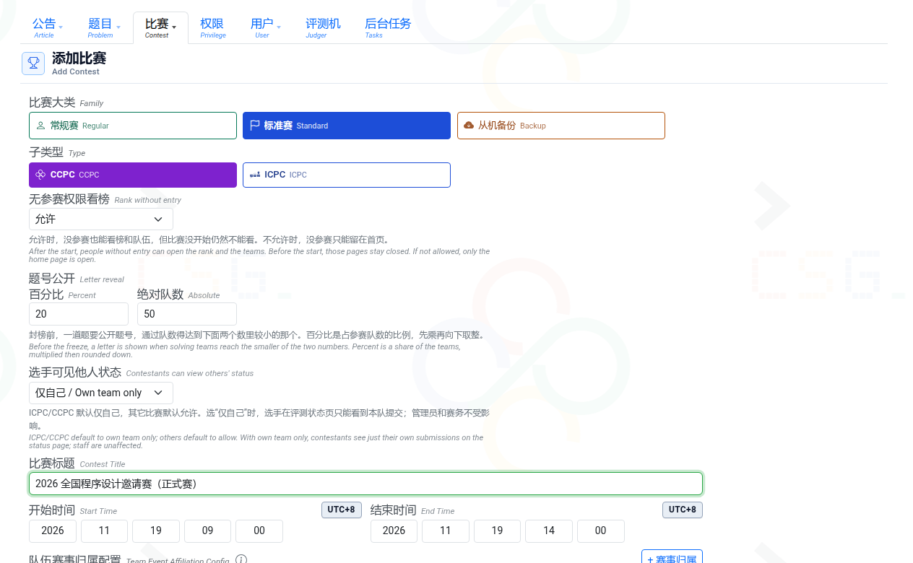

ICPC 与 CCPC 在公开榜单的题号揭示规则上有所区分：

- **ICPC**：自开赛起，各题按 `A`、`B`、`C`……公开显示题号，公开榜、评测状态与选手视角一致。
- **CCPC**：开赛后公开榜先预留全部题目位置但以隐藏占位显示，直到某一题的通过队伍数量达到「题号公开」设置的条件（百分比与绝对队数两项中的较小值），该题才对公众和未过题观众显出真实字母与题名。未揭示题目时，选手在题目集页仍可正常浏览所有题面并提交，但公开榜和他人评测状态记录中不展示未揭示题的题号。

其余关键开关按赛场要求设置：

- **无参赛权限看榜**：默认为「允许」。未登录观众或未参加本场的账号，在开赛后可以打开榜单与队伍列表；未开赛前仍受保护，只停留于首页。改为「不允许」后，无本场参赛权限的访客无法打开榜单与队伍页面。
- **选手可见他人状态**：ICPC 与 CCPC 默认均为「仅自己」，此时参赛队在评测状态页只能看到本队提交，管理员与赛务视角不受影响。
- **锁定登录 IP**：默认关闭。开启后，每支队伍在首台机器登录后将绑定该机器 IP，换机登录须经管理员在「账号 → 队伍状态」中解锁；工作人员账号不受 IP 锁定限制。无论是否开启锁定，所有队伍登录均会记录来访 IP。
- **比赛公开与顶部横幅**：新建的比赛默认处于隐藏状态，赛前核对无误后，请在后台比赛列表将其切换为「公开」，否则队伍无法进入该场。在后台比赛列表中点击任意比赛的编号 ID，即可打开「比赛顶部图片」管理弹窗，上传 SVG、PNG 或 JPEG 横幅作为该场专属页头横幅，宽屏与手机端都会按比例适配。

### 3.2 封榜设置

封榜时间设有「距结束」与「结束后」两个填写框，单位均为分钟。


「距结束」填写结束前最后多少分钟冻结公开榜单，例如标准 5 小时赛填 `60`，填 `0` 表示全程不封榜。「结束后」填写比赛截止后继续保持冻结的分钟数，供赛后核查申诉或等待闭幕式滚榜前对外保持悬念，填 `0` 表示比赛时间一到立即自动解榜。管理员与赛务视角随时可以切换实时榜与终榜核对，不受封榜影响。

### 3.3 获奖基数、获奖方案与赛事归属

**获奖基数**在添加比赛时确定，后续修改比赛子类型不会改变该值，比赛实时榜、外榜、获奖导出、颁奖编排和滚榜全部沿用同一口径计算名额：

- **过题为基数**：仅统计至少通过一题的正式参赛队，新建 ICPC 默认采用此项。
- **交题为基数**：所有至少提交过一次代码的正式参赛队（含只有编译错误的队伍）均计入基数，新建 CCPC 默认采用此项。
- **全部为基数**：所有正式参赛队不论是否交题均计入基数。

「获奖方案」面板整合了预设模板、奖牌名称、打星规定、金银铜名额及五类专项奖规则，随比赛保存，也可在赛后「榜单 → 奖项」或「颁奖编排」页继续微调：

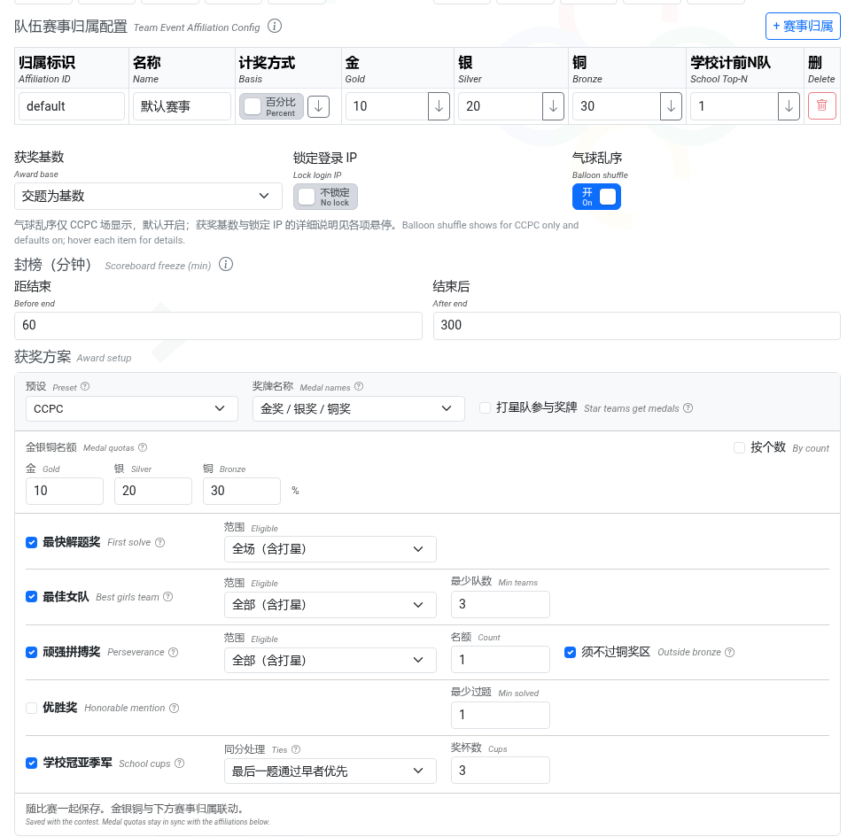

- **预设与奖牌名称**：可在「CCPC」「通用」预设间一键套用常用规则，改动任意开关后切为「自定义」；奖牌称呼可切换为「金奖 / 银奖 / 铜奖」或「一等奖 / 二等奖 / 三等奖」。
- **打星队参与奖牌**：开启后，打星队按自身成绩落入对应的奖区区间领取奖牌，同时不占用正式队的名次顺位与获奖基数；获奖名单、颁奖编排及滚榜中均标明为打星队。
- **金银铜名额**：默认按有效参赛队百分比计算（例如 `10% / 20% / 30%`），在百分比模式下某档填写 `100` 以上表示减去 `100` 后的固定队数（例如填 `115` 代表固定 `15` 队），方便百分比与固定数混合编排；勾选「按个数」则全部按固定名额计奖。
- **专项奖**：可分别勾选并设置**最快解题奖**（单题全场首答、正式队首答或两项兼发但同队不重复颁发）、**最佳女队**（限铜奖区内女队且满足最少女队数门槛）、**顽强拼搏奖**（非奖牌得主中按各题首次通过最晚时刻排名，可选是否须落在铜奖区之外）、**优胜奖**（未获奖牌但过题数达到门槛）及**学校冠亚季军**（按校名首次出现取前若干名，同分可按最后一题最早通过优先或并列共享）。

**队伍赛事归属配置**紧接在比赛表单上方，用于支持同场多组别计奖（例如本科组、高职组、邀请组各自独立算奖与校排）。若全场比赛统一计奖，仅保留默认一行即可，榜单与滚榜不显示冗余的归属筛选；配置两个及以上归属后，各归属独立核算金银铜比例和「学校计前 N 队」，榜单和滚榜顶部会自动提供按归属筛选功能。行末的下箭头可将当前格子的数值一键向下复制到后续归属行。

## 4. 赛前：题目、五类评测、题包转换与题册打印

### 4.1 添加题目与多语言题面

从管理后台进入「题目 → 添加题目」。填写题目标题、时间限制与内存限制，正文支持 Markdown 与 LaTeX 数学公式。如果某一段正文希望直接交由完整 LaTeX 排版规则渲染（如 `\textbf` 或居中图片排版），可在该段开头单独写一行 `__LATEX__`。

同一道题目支持维护多份语言版本的题面，列表中最上方的一份为默认语言。各语言可单独控制启用或关闭，关闭后选手端看不到该语言版本，原题面与数据仍保留。如果需要下发纸质版原样排版或包含复杂插图的题面，请先保存题目，再在多语言 PDF 入口上传对应语言或统一的 PDF 文件。

题面中需要插入图片时，先保存题目，再打开该题的「附件」管理上传图片，将生成的相对路径嵌入正文即可。

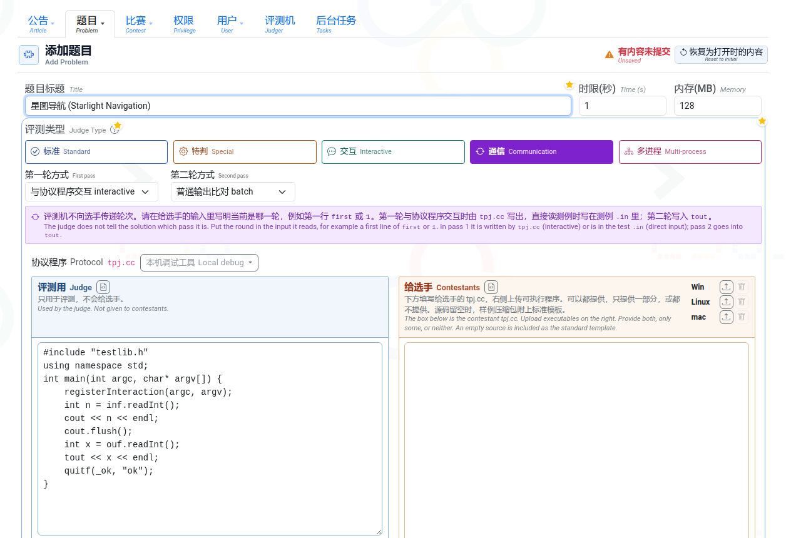

### 4.2 五类评测与本机调试工具

新建或编辑题目时，可在「评测类型」中选择**标准**、**特判**、**交互**、**通信**或**多进程**。选择标准以外的四类后，页面下方会出现协议程序 `tpj.cc` 编辑区，协议程序源码在保存题目后写入服务器。

| 评测类型 | 适用场景与约定 |
| --- | --- |
| 标准（Standard） | 常规单输入对单输出比对，每个 `.in` 必须配同名 `.out` |
| 特判（Special） | 答案不唯一或需要容差校验，上传或填写 `tpj.cc`（基于 `testlib.h` 的 `registerTestlibCmd`） |
| 交互（Interactive） | 选手程序与 `tpj.cc`（`registerInteraction`）通过标准输入输出实时一问一答 |
| 通信（Communication） | 同一份选手程序按顺序运行两轮（如编码端与解码端），每轮独立重新启动且工作目录与内存不互通；第一轮可选与协议程序交互或直接读测例 `.in`，由协议程序将跨轮数据写入 `tout`；第二轮可选普通输出比对（须有 `.out`）或继续与 `tpj.cc` 交互；时间限制对每轮分别判定，测试点总耗时与内存取两轮较大值 |
| 多进程（Multi-process） | 同一份选手程序同时并行启动 `2～8` 个角色进程（编辑页填「选手进程数」），各进程通过 `argv[1]` 读取自身编号 `"0"` 至 `"N-1"` 并在每次输出后及时 flush；`tpj.cc` 编写为标准 C 调度进程，从标准输入读测例，命令行成对接收各角色管道句柄并向标准输出首行写出 `1`（通过）或 `0`（不通过） |

特判与协议程序在运行校验阶段不受常规默认栈空间制约，与题目总内存上限统一管理，无需担心较深递归导致误判。上传单个测例或压缩包时，文件扩展名中的大写字母会统一规范为小写，同一批次里请勿同时放入大小写仅不同但同名的文件（如 `1.in` 与 `1.IN`）。

协议程序区域分为左右两栏：左侧**评测用**仅在评测机判题时运行，不会对选手公开；右侧**给选手**填写面向参赛队的公开模拟交互器或调度器源码（留空时样例包会附上标准骨架），同时支持上传预先编译好的各桌面平台可执行程序，方便参赛队在本机直接用测试工具对样例验证。点击协议区上方的「本机调试工具」按钮，可下载对应操作系统的本地测试工具包。

以下给出常用的浮点误差特判 `tpj.cc` 模板供参考：

```cpp
#include "testlib.h"
#include <cmath>

const double eps = 1e-6;

int main(int argc, char* argv[]) {
    registerTestlibCmd(argc, argv);
    while (!ans.seekEof()) {
        double expected = ans.readDouble();
        double actual = ouf.readDouble();
        if (std::fabs(expected - actual) > eps) {
            quitf(_wa, "expected %.6f but found %.6f", expected, actual);
        }
    }
    quitf(_ok, "accepted");
}
```

### 4.3 题包转换与批量导入导出

使用 Polygon 命题或导入外部标准题包时，进入「管理后台 → 题目 → 题包转换」。页面支持一次单选、多选或将多个导出的 `.zip` 题包直接拖入解析区，按选择顺序依次解析并列成题目表格；解析完成后可通过工具栏的「追加」继续添入新题包，或「清空」重来。在表格最左侧「索引」列拖动 `⠿` 手柄（或聚焦手柄按键盘 `↑` / `↓`）可调整整场题目的先后次序，随后的「打包」与「导入」均严格按表格当前顺序生效。若 `.zip` 在 macOS 环境下压缩而携带了系统隐藏目录，解析过程会自动跳过，无需提前手工解压剔除。

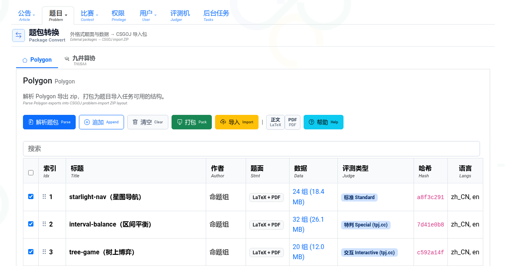

表格内可逐题检查标题、数据组数与总体积，点击数据链接可预检测例文件名；同时可切换优先导入 LaTeX 正文还是 PDF 题面。选中对应题目点击「导入」时，若题库内已有同源题目，系统会列出已有题号与当前标题，由管理员选择**跳过**或**覆盖已有题**（保留原题号及历史提交记录，更新题面和测例）。若需要把部分或全部题目导出备份，或迁移到另一台比赛服务器，可在「题目 → 题目导入/导出」一页按题号范围、题号列表或整场比赛导出完整题包（含附件、多语言题面、侧车协议程序以及该题历史不同评测结果的验证代码）；在该页上传题包导入时，可勾选「自动提交包内代码」，让系统在新环境自动重测随包附带的提交代码，快速确认新题在新评测机上的判定一致。

针对整场比赛的一键备份迁移，可在比赛后台「备份 → 归档导出」生成包含题目、配置、队伍名单（含保留加密还原能力的队伍口令）、提交记录在内的完整比赛包；在另一台服务器导入比赛包后，新建比赛会自动处于归档冻结状态，需继续修改时在比赛后台解除归档即可。

### 4.4 题册排版与打印 PDF

比赛题目录入并核对完毕后，进入比赛后台顶栏的**题册**（Contest Print），浏览器会实时将当前比赛所有题目排成纸质比赛题册，通过浏览器打印对话框选「另存为 PDF」即可直接印制或分发。

工具栏支持在整场题目所含的语言并集中一键切换语言版本，缺少所选语言的题目会自动回退使用其默认语言；若某题配置了 PDF 直通题面，题册会在该题位置直接内嵌 PDF 页面。「设置」弹窗中提供四项定制：勾选「包含目录页」在封面后插入题号与页码目录；勾选「打印 PDF 显示页码」在每页页脚居中显示「当前页 / 总页」（封面不计入页码）；上传「封面 Logo」将赛事标志放在自动封面的正中央；或直接上传「自定义封面 PDF」替换自动封面，沿用承办方设计的成品封面。

## 5. 赛前：机位抽签、账号生成、客户端 IP 与命令行工具

### 5.1 机位抽签

进入左侧栏「工具集 → 机位抽签」，该工具可在未登录状态下独立打开使用。准备考场机位分区表和参赛队伍表后，可用 Excel 模板上传（考场与队伍也可合并放在一张表内），或直接从表格软件复制文本粘贴到右侧文本框；每行考场支持用 `#` 或制表符隔开写 `名称#起始编号#结束编号` 或 `名称#座位数`。

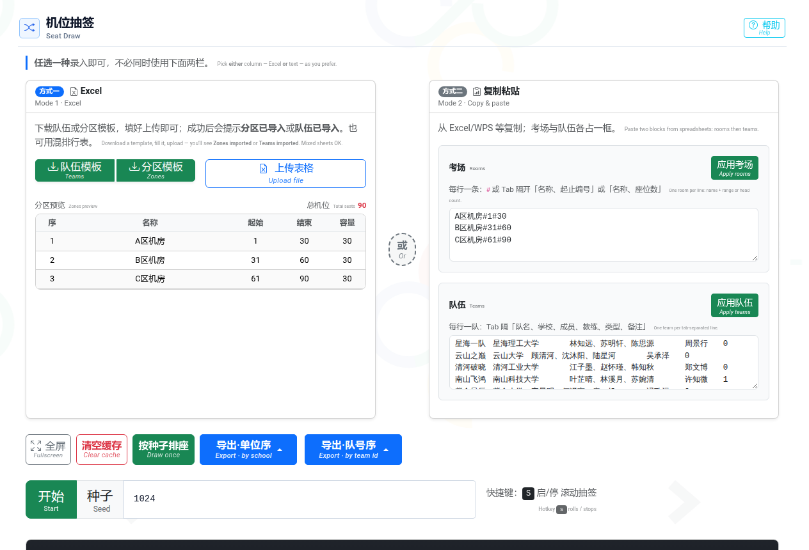

承办方与管理员在赛前保存完全相同的考场和队伍清单。开幕式或赛前抽签时，在页面填入公开的「种子」（或现场随机生成后记下种子字符串），点击「开始」或「按种子排座」（全屏下可用空格 / **`S`** 键控制滚动停下）。只要考场清单、队伍清单与种子一致，任何机器随时都可复现完全一致的座次表；抽签完毕后可分别按「单位序」或「队号序」导出表格，直接用于现场张贴和后续导入比赛。

### 5.2 队伍账号与密码条

在具体比赛页面的「管 → 账号 → 队伍」进入队伍生成页。既可从制表符分隔的文本直接粘贴，也可下载内置模板在表格软件中填好后导入。如果已使用机位抽签工具完成排座，将导出的机位列一并填回即可。

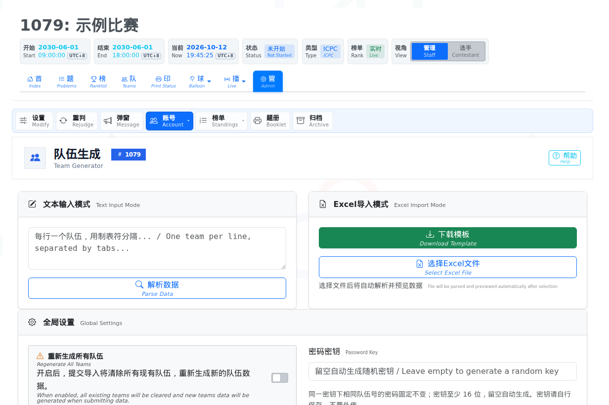

「密码密钥」框可填入不少于 16 位的密钥文本，在同一密钥下相同队伍号生成的登录口令始终固定一致，留空时会自动生成一段随机密钥，务必复制留存且不要外传；修改密钥仅作用于后续新生成的密码，不会改变已入库队伍的现行口令。需要整批重导队伍时打开「重新生成所有队伍」，若新提交的数据校验不通过，原有队伍数据会保持原状；重生成队伍不会删除已有的工作人员账号。

账号导入完毕后，在页面右下方点击「导出密码条」下载带裁切边框和密码信息的多种打印排版表格，连同「导出标准数据」一同妥善归档，方便按校区、队伍或机位秩序拆分装袋并在现场有遗失时补发。

### 5.3 赛务工作人员账号

从同一场比赛的「管 → 账号 → 赛务」进入工作人员生成页。建议为每名现场气球配送员单独生成一个 `balloon_sender` 账号，为每台打印工作站单独生成一个 `printer` 账号，并按分工预先填好所负责的「分区 / 房间」。填入指定房间或分组后，该打印员或气球账号登录后将自动锁定只查看与处理对应区域的任务。

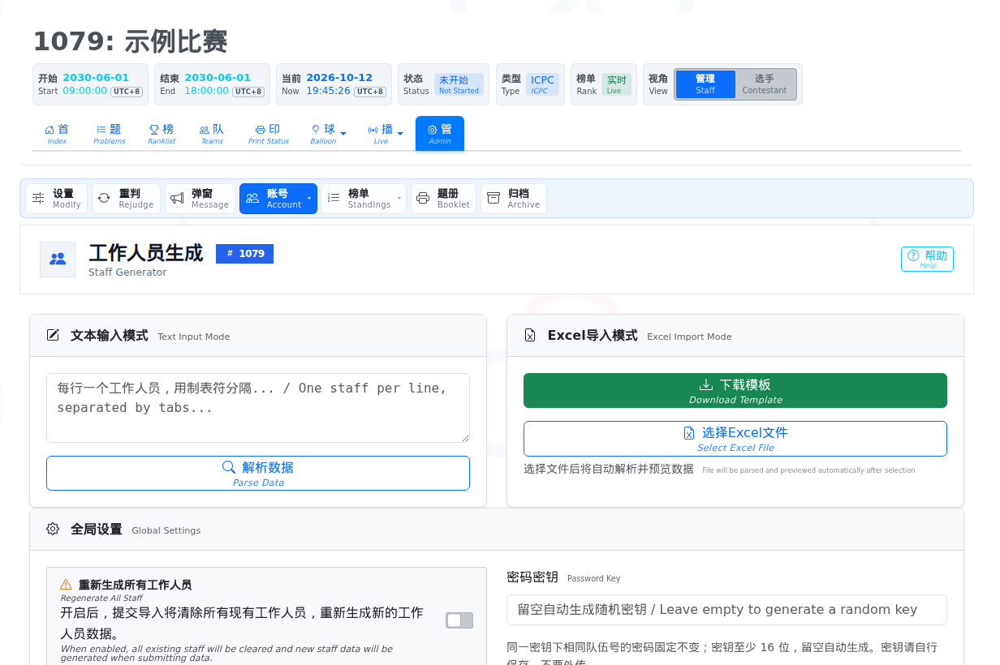

另外建议额外生成至少两个比赛内管理员（`admin`）账号：一个交由现场赛务执裁使用，另一个专用于闭幕式投屏与滚榜操作。

### 5.4 客户端 IP 管理

若现场允许使用命令行交题或希望赛中精确定位机器，从比赛后台「管 → 账号 → 客户端管理」维护参赛队伍与机器 IP 的对应关系，系统提供三种录入方式：

- **批量导入**：按「队伍号 + 制表符 + IP」粘贴文本，或通过 Excel 模板上传。
- **收集模式**：点击右上角「收集模式」打开开关后，巡场或让各选手在各自选手机打开本场比赛首页（保持未登录状态），在页面出现的「账号收集」框里提交该机所分配的队伍号。登记成功后，该机浏览器首页会以大字显示当前登记的队伍号便于巡视核对，输入错误可直接重新提交覆盖；此模式下同页右侧「工作人员登录」仍然可用，收集模式会在开赛前 10 分钟自动失效，赛前建议手动关闭。
- **缺 IP 快速补录**：表格上方实时汇总覆盖情况，显示「已录 IP x / y 队」「x 队没录 IP」与「x 条 IP 没对应队伍」。点击「x 条 IP 没对应队伍」可筛选出异常登记行；点击「x 队没录 IP」则会打开按队号排列的快速补录窗口。窗口会自动根据已有记录推算网段前缀，管理员在每行只需输入 IP 末段数字（或粘贴完整 IPv4 地址）后按回车即可跳到下一行，也可以填完多行后一次性批量提交；若发现目标队伍已被其他同事先期登记，行内会提示已占用 IP 并支持按需点击追加为第二台机器。

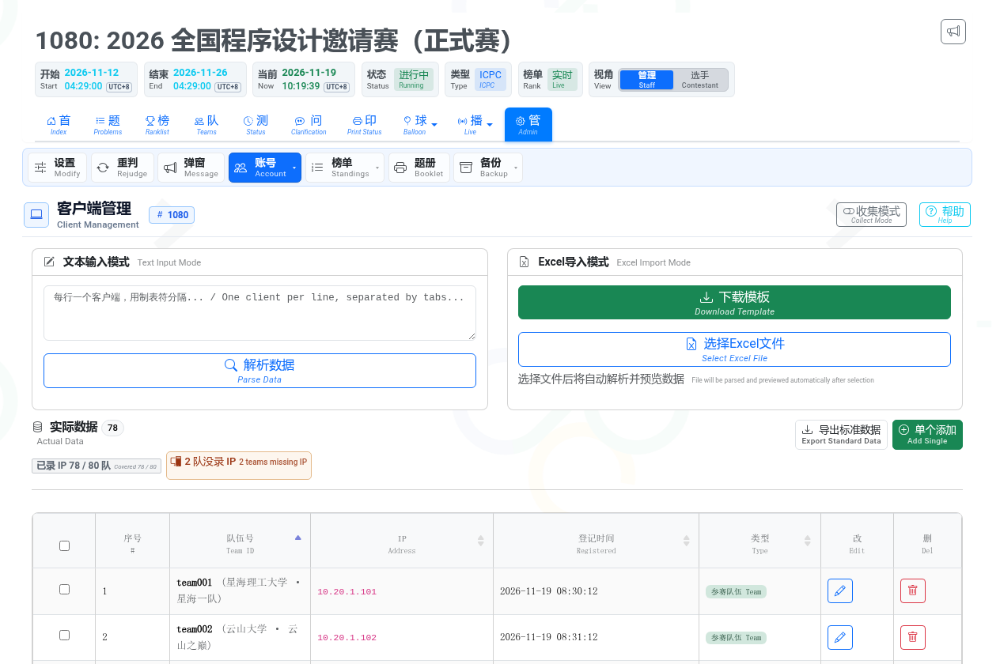

### 5.5 命令行交题与打印（`csgsubmit` 与 `printfile`）

对于提供终端交互提交的竞赛机房环境，选手可在代码所在目录下运行命令行工具完成判题与代码送印，免去切换浏览器的步骤。对应的程序文件可在比赛任意题面页的「命令行交题」下拉菜单，或代码打印与打印状态页的「命令行打印」下拉菜单中下载（含各主流桌面与服务器系统对应版本）。

赛前为选手机预置环境可根据机房系统使用方式任选其一（下方 Linux 示例使用 `csgsubmit_linux_amd64`，Windows 与 macOS 请替换为下载到的对应可执行程序文件名并在命令行中用管理员权限安装）：

1. **整机免比赛号根地址预置（推荐用于热身赛、正式赛连续共用一套账号的环境）**  
   在每台选手机（或制作机房母盘时）运行：
   ```bash
   chmod +x csgsubmit_linux_amd64 && sudo ./csgsubmit_linux_amd64 install --system --init "https://oj.example.edu.cn"
   ```
   只传入服务器根地址后，工具每次运行会自动向站点匹配当前机器座位 IP 已绑定的进行中（或含单队延时）比赛，或当前唯一进行中的公开比赛，不会误入隐藏比赛；热身赛结束换场至正式赛时，只要在正式赛后台重新绑定客户端 IP，选手机即便不重开终端、不重装程序也可自动指向新一场比赛。若只需锁定单一固定比赛，把引号内地址改为该场任意一道题的题面网址即可；需要撤销整机预置时运行 `sudo csgsubmit install --system --clear-preset`。
2. **按系统账号分别预置（适用于热身赛与正式赛分别使用不同系统账号的机房）**  
   先执行 `sudo ./csgsubmit_linux_amd64 install --system --clear-preset` 安装全局 `csgsubmit` 与 `printfile` 命令并清除整机默认比赛；再仅对已建好的比赛账号执行（`--no-login` 只校对场次，不在未开赛前留下队伍登录记录）：
   ```bash
   sudo -iu 热身赛账号 csgsubmit --init "https://oj.example.edu.cn/cpcsys/contest/problem?cid=1080&pid=A" --no-login
   ```
3. **便携拷贝方式（适用于统一镜像无法逐台连网安装）**  
   在联网机器执行 `./csgsubmit_linux_amd64 --init "题面或根地址" --portable` 生成同目录的 `csgsubmit.json`，将程序与该配置文件一同复制到选手机本地硬盘后，在目录内运行一次 `./csgsubmit_linux_amd64 install` 即可（请先从 U 盘拷贝至本地硬盘再执行，避免受挂载权限限制）。

赛前抽检请在选手机终端运行 `csgsubmit info` 核对当前匹配到的比赛与来源；在已绑定过 IP 的测试机运行 `csgsubmit login` 可验证免密自动登录。

**常用选手命令**：

- `csgsubmit a.cpp` 或 `csgsubmit main.cpp --problem B`：向当前比赛指定题目提交源码并列出确认摘要，`csgsubmit contests` 可列出进行中与即将开始的场次，`--cid <比赛ID>` 可单次临时指定场次，`csgsubmit status` 查看最近评测结果。
- `printfile a.cpp`（与 `csgsubmit print a.cpp`、`csgsubmit -p a.cpp` 相同）：提交代码送印，支持从管道读取（如 `cat a.cpp | printfile - -y`），加 `-w` 或 `--wait` 可在终端内阻塞等待直至收到出纸完成或拒印通知。
- `csgsubmit prints`：查看本队历史打印任务列表及状态计数，加打印编号 `csgsubmit prints <编号>` 可直接读取该次打印的源码原文。

## 6. 赛中：队伍状态、打印、气球、大屏榜单、直播、主从备份与对外接口

### 6.1 队伍状态、单队延时、弹窗与重判

比赛过程中可在「管 → 账号 → 队伍状态」查看全部队伍与工作人员状态，页顶支持一键筛选「未登录」（尚无登录 IP 记录）或按正常、结束、禁赛筛选。对打开了「锁定登录 IP」的比赛，当选手因机器故障换座时，可在此页面一键解锁对应队伍的 IP 绑定。

管理员可在该页单个或批量将队伍状态调整为「正常」「结束」或「禁赛」。设为结束或禁赛后，对应队伍立即失去看题与交题权限，改回正常后可立即恢复。如果个别队伍因赛中更换硬件或断电耗费了有效比赛时间，选中对应队伍点「特判结束时间」，按常用分钟按钮或直接输入具体截止时刻。单队延时只延长所选队伍自身的有效交题与命令行匹配窗口，全场原本的封榜时间与终榜揭晓时间保持不变。

需要向全场在线浏览器推送置顶广播通知时，进入「管 → 弹窗」发布即可；若赛中调整了题目测试数据，进入「管 → 重判」可按题号或提交编号重测。

### 6.2 代码打印

建议将实体打印机连至一台 Windows 电脑并设为系统默认打印机，由打印员登录对应的 `printer` 账号打开代码打印页；多个考场配有各自打印机时，按分区对应使用各自 `printer` 账号。

工具栏可在 **Lodop**（默认）与 **CSGPrint** 两种打印控制组件间切换，右侧「插头」按钮用于检查与连接当前选中的打印服务。改用 CSGPrint 时从旁边的问号下载对应系统程序，保持后台窗口开启后点击插头连接即可；更改操作系统默认打印机后会自动同步生效。

工具栏上的 **彩色模式 / 黑白模式** 用于适配彩色喷墨或黑白激光打印机：黑白模式会改用字体粗细、斜体与下划线区分关键字、常量、字符串和注释，确保纸面清晰可辨。建议赛前在工具栏点击**打印示例页**（直接按当前工具、色彩设定及间距打印样张与一段 C++17 示例源码，不会写入正式打印队列），待确认版面与默认打印机出纸顺畅后再将队列设为自动打印。页面顶部右侧可按等待、打印中、已打印、已拒绝筛选记录；已打印行支持双击「重打」，租约超时卡住的任务支持双击「释放」。

### 6.3 气球队列与气球总览

气球管理员（`balloon_manager`）在比赛期间负责统筹全场的过题气球任务；开赛前也可提前进入页面调整小票规格与测试出票。界面按键盘 **`A`** 键在两种工作模式间切换：**分配模式**用于配合现场持手机的配送员（`balloon_sender`），观察各配送员抢单与送达动态，也可手动将某条任务指派给特定配送员；**标记模式**则面向集中印刷小票、手写编号派单的赛区，点击任务行直接标记已下达，不强制要求配送员账号介入。

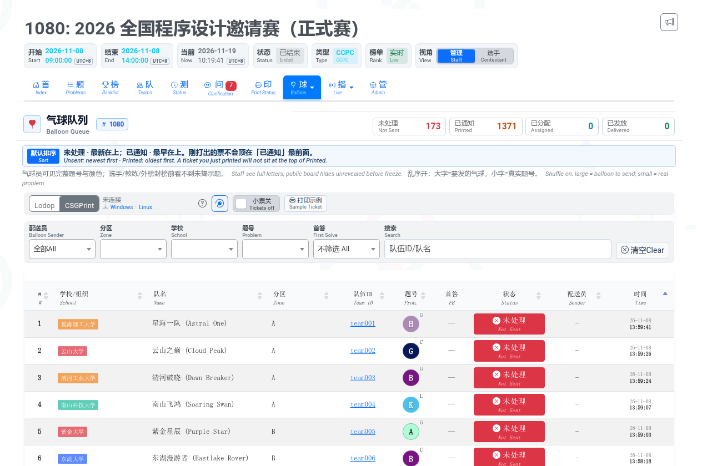

开启工具栏的**小票**开关后，可设置打印工具（Lodop / CSGPrint）、纸宽与走纸尺寸（也可从「常见规格」选取预设）、热敏黑白或彩色版面、每页张数及自动出票方式。小票排版会自动放大队号与分区号使其不发生省略号截断，并对全场首答、正式队首答给出对应徽标。开启小票后，在列表上**双击任意序号**即可免打印控件在浏览器内直接预览单张补打与同页连排的真实版面；点击工具栏**打印示例**下拉，可选择**普通**、**全场首答**、**正式队首答**或**双首答**四种通用模板直接试打样张，不会改动正式气球队列状态。

CCPC 比赛默认开启「气球乱序」：在同一所学校或同一支队伍上，系统为每道题一对一分配专属要发放的气球字母与对应颜色，但不将同一色块直接等同于公开字母题号。此时页面列表与小票均以大字显示**要发放的气球字母**、旁侧以小字注明真实题号，防止观众或邻座队伍借气球颜色提前猜出未揭示题目。此外工具栏的**封榜停**开关默认开启，榜单到达封榜时刻后，后续过题任务不会自动打印小票并给出提示，需人工确认规则后决定是否继续发放。

持有配送员账号（`balloon_sender`）的志愿者通过手机自带浏览器（不建议使用社交软件内置浏览器）连接现场网络登录，即可领取本区任务，送达队位后双击标记「已发放」，如需撤销可双击尚未完成任务的时间列退回队列。此外，顶栏「球 → 气球总览」以榜单表格阵形实时统计全场各队各题的气球四态（红色未处理、黄色已通知、青色已分配、浅绿已发放），支持在工具栏调节 **0～3 档**列表疏密与点击页头状态计数器快速定位到第一个未处理格子。

### 6.4 实时榜单与独立外榜

比赛页面中的实时榜单支持四套外观（默认主题、深色主题、浅色主题、素表）及四档列表疏密，快捷键 **`A`** 开关自动刷新、**`B`** 开关自动循环滚屏、**`F11`** 全屏展示。打开「动态榜」或拖动时间进度条可回放比赛过程中任意时刻的榜单与首答演变。点击队伍名称或队伍编号区域可查看完整参赛成员与教练信息卡片；点击任一道题的题格可按时间倒序查看该队在本题的有效提交历史与判题结果（已通过后的后续提交不计入，CCPC 未揭示题不泄露题号），避免在仅移动鼠标时频繁弹出窗口遮挡周围名次。

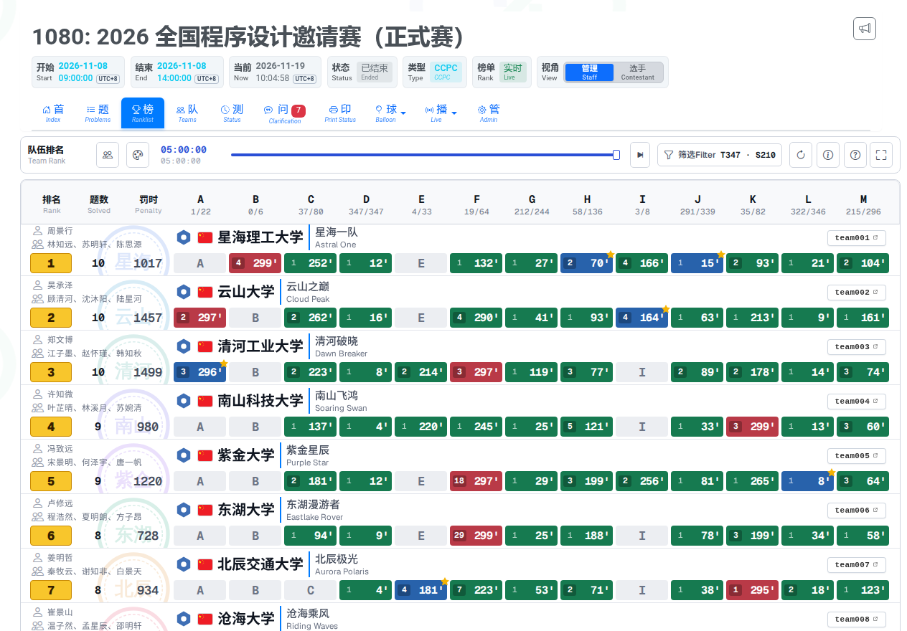

工具栏**筛选**面板同时支持按学校或队伍简单勾选、**女队**筛选以及**高级**多条正则表达式匹配：在「高级」页为每条规则编写正则并勾选要匹配的字段（如学校写 `^星海`，或队员写 `^林`），在规则下方设置「任一满足」或「全部满足」，选择筛选置顶、仅筛选或显示全部即可在不改变全场名次线的前提下单独关注目标队伍；全部筛选规则保存在本机浏览器，支持导出成规则文本发给他人直接导入使用。

当赛场需要对校外观众提供高并发访问而将外榜部署在独立服务上时，进入比赛后台「管 → 榜单 → 外榜」打开外榜推送工作台：点击「导入配置」粘贴目标外榜的 JSON 配置文本（或拖入配置文件），设置 10 至 120 秒的推送间隔即可按周期自动向外榜服务器推送 JSONP 实时榜单（同时提供与网页同步间隔的命令行推送工具打包下载）。独立外榜站点面向访客直接开放浏览，系统管理员登录后可在列表页上传各场页眉横幅、通过 ZIP 整包备份恢复各场外榜数据，在比赛解榜推送终榜后观众页标题栏还会开放独立外榜滚榜和直播视角入口。

### 6.5 直播控制台与大屏导播

持有 `watcher` 账号的直播工作人员登录后，点击比赛页「播 → 直播」进入直播控制台。控制台页面提供一条带临时口令的「节目画面」浏览器地址及下面**九张独立场景卡片**：主画面、直播榜单、比赛计时、队列·过题·气球、评测队列、最新过题、各题统计、校徽墙、气球层。

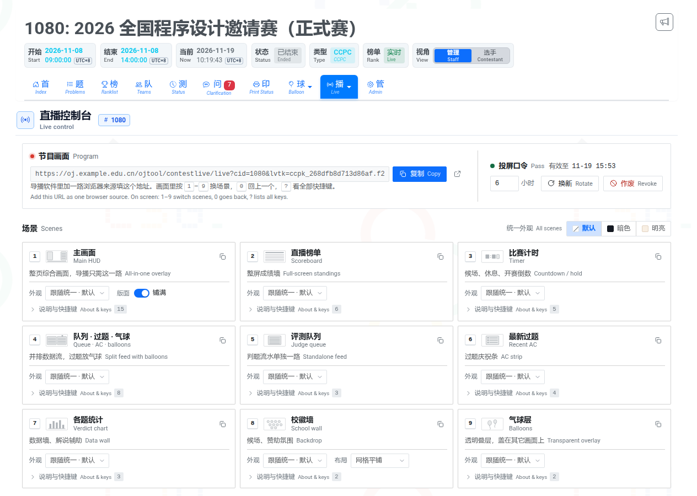

在 OBS Studio 等导播软件中只需添加一路「浏览器」来源并填入节目画面地址（如需固定打开某单一场景，也可直接复制该卡片右上角带锚点的专属链接）。投屏页面默认外观保持整页透明背景（暗色场或马卡龙亮色则铺实色底），便于在导播台里透明叠放在现场视频层上方；各场景支持在画面内用键盘实时切换与调控：

- **`1`–`9`** 无刷新切换九大场景，**`0`** 回到上一个场景，**`?`** 弹出快捷键速查浮层（查看后记得按 **`Esc`** 或 **`?`** 关闭以免进入直播画面）。
- **`O`** 调透背板一档、**`Shift`+`O`** 调实背板一档（共 6 档），只改变背景面板透明度而不淡化文字（独立链接也可携带 `?o=0` 至 `?o=5` 固定初始透明度）；**`Shift`+`数字`** 可按需隐藏或显示对应分区的局部图层（例如主画面用 **`Shift`+`8`** 开关左右两栏铺满、**`Shift`+`1`** 隐藏整条左栏）。
- **`L`** 在主画面内嵌榜与直播榜单上显示或隐藏队伍行下方的**过题时间轴**（以极细长条直观反映全场整点刻度、封榜黄色区间与该队各题 AC/首答/热力提交脉络）。
- **`T`** 在比赛计时页循环切换倒计时/正计时/相对开赛等多种读数方式；**`=` / `-` / `\`** 缩放字号；**`[` / `]`** 临时切换或恢复预设外观；**`G`** 立即从控制台同步保存好的全局画面参数。

控制台顶部右侧可查看、按小时换新或作废投屏口令；下方支持向主画面底栏发送实时长连接滚动播报消息、编辑底栏右侧常驻文案与管理左上角多枚自定义徽标，同时在「投屏客户端」列表中实时查看当前连上大屏或导播台的每一路画面分辨率、字号、透明度档位和缩略示意，点击某一行即可开启对该台机器的远程按键遥控并看到回执反馈。

### 6.6 主从实时备份

重要正式比赛建议在另一台服务器上准备热备场次。主机管理员在比赛后台进入「管 → 备份 → 主从备份」，打开右上角「开放本场的备份接口」，核对供从机访问的站点根地址后点击「下载从机配置」保存包含访问令牌的 `.json` 配置文件。

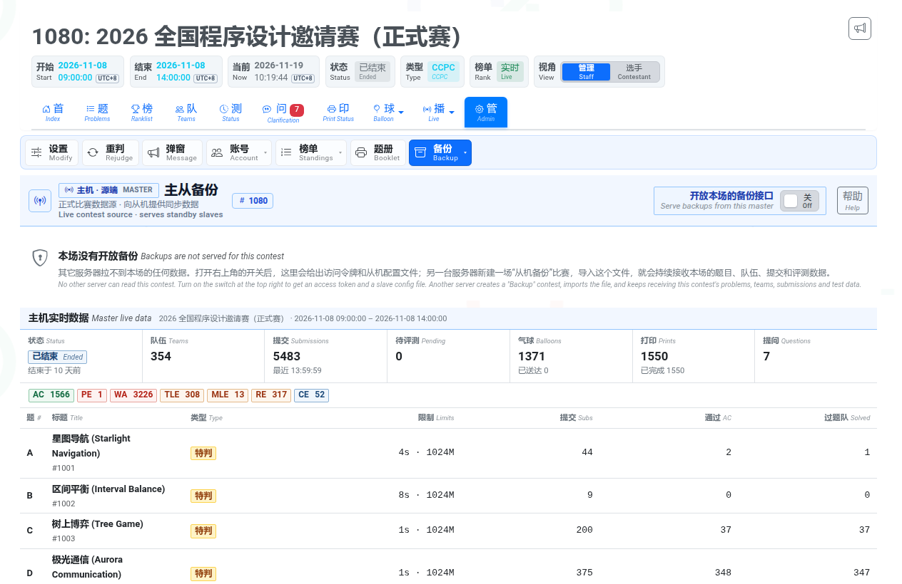

在备用服务器上由系统管理员新建比赛，大类选「从机备份」，将刚刚下载的配置 JSON 拖放或粘贴至表单中，系统会自动校验并预填主机标题；保存后直接进入从机控制台并开启「持续接收主机数据」。从机建立长连接后实时同步主机题目、参赛队伍、赛务账号、提交记录与评测数据（若长连接遇网络波动则自动回退为定时轮询并在恢复后自动切回实时流），关闭浏览器页面不会影响后台继续同步。控制台左侧逐项对照主机与从机的题目数、队伍数、提交数和各判定结果统计。一旦主机发生故障且至少完整同步完一轮后，在从机页面点击「转为正式比赛」，备用场次立即恢复原赛制与公开状态并开启评测，参赛队继续沿用原有账号与密码登录续赛。注意主机与从机所在服务器必须保持相同系统时区。

### 6.7 对外数据接口（CCPC Contest API 与 ICPC CCS API）

需要对接自研记分牌、外部分析工具或 ICPC Tools（如 CDS、Resolver）时，系统为标准赛提供两套标准只读（含赛务局部状态操作）接口，并在比赛顶栏「播」菜单下直接内嵌了**CCPC API** 与 **CCS API** 在线试调控制台。试调页可直接沿用当前页面登录身份，也可填入临时账密（HTTP Basic）或访问令牌（Bearer PAT）点击验证，随时查看返回报文并一键下载完整接口清单、`Postman` 集合和 `OpenAPI` 规范。

- **CCPC Contest API（`/csgapi/ccpc/v1/`）**：专为现场赛开发工具与直播、榜单设计。支持通过 `?view=public` 在赛务视角下预览公众看到的数据形状，严格执行 CCPC 未揭示题目掩罩（未揭示前不暴露字母题号，仅返回稳定槽位 `u…`），并包含事件短轮询（`/events`）、SSE 事件流（`/event-stream`）、以及供授权赛务更新气球和打印状态的 `PATCH` 接口。
- **ICPC CCS Contest API（`/csgapi/ccs/`）**：严格遵循 **ICPC CCS Contest API 2026-01** 规范实现。支持竞赛元数据（`contests`、`state`、`judgement-types`、`languages`、`problems`、`groups`、`teams`、`organizations`）、实时赛况流水（`submissions`、`judgements`、`runs`、`awards`、`scoreboard`）以及 NDJSON 增量事件流（`event-feed`），配合专用的 `api_reader` 等赛务只读账号即可接入各类标准 ICPC 生态工具。

## 7. 赛后：获奖导出、颁奖编排与闭幕式滚榜

### 7.1 获奖名单导出

比赛结束后，先进入评测状态页确认所有提交均已出结果、无排队或评测中记录，再打开比赛后台「管 → 榜单 → 奖项」。如现场裁判委员会确认需调整获奖称号、是否允许打星参与、顽强拼搏或最佳女队门槛，可在页顶展开「计奖配置」保存生效。确认各归属获奖名额与名单无误后，直接导出 Excel / CSV 文件移交证书与奖牌制作。

### 7.2 颁奖编排、全屏展示与离线网页 / PPT 导出

进入「管 → 榜单 → 颁奖编排」可将各参赛归属的冠亚季军学校、金银铜奖以及本场实际产生得主的专项奖整理成可直接上台宣读的幻灯片序列。

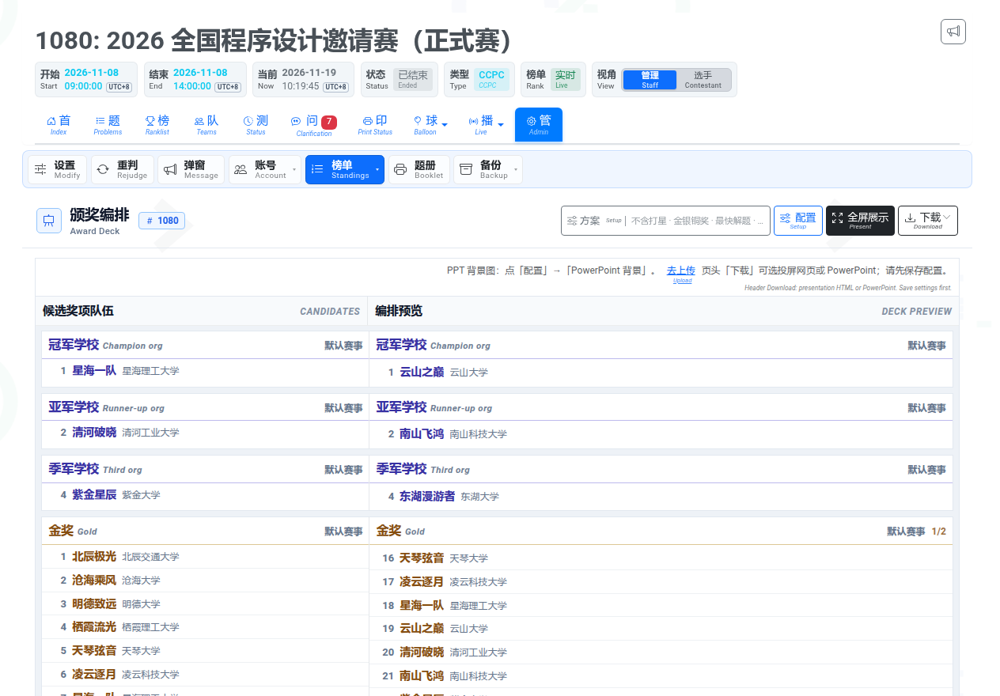

点开工具栏「配置」可按需要调整同奖名次展示顺序、是否按赛事归属分页、是否显示学校或名单分栏列数（建议保持「自动」以根据队数与字符长度实测择优分栏）。配置支持开启**每页队数自动适配**（在目标均值与上下容差间自动均衡拆页，避免尾页人数过少），以及选择**比赛标题**显示开关（便于搭配已经印刷了赛事名称的承办方主视觉背景）。内置**金箔典礼**、**红金荣耀**、**海蓝竞技**、**青玉雅致**、**夜幕星蓝**、**深空墨黑**、**素瓷宣纸**与**晴空简白**八套仪式主题；如上传了自定义背景图，画面内容底板与明暗字色会根据图片亮度自动配对，还可配置**页眉、页脚三等分避让区域**及高度比例，确保现场主视觉里的Logo和角标不被名单或底板遮挡。

调整后保存配置，在闭幕式现场可直接点「全屏展示」连接大屏翻页宣读；若会场电脑不便连接服务器，点击「下载」可选择：

- **投屏网页**：生成单个内嵌精简字库的离线 HTML 文件，用任意现代浏览器离线双击打开即保持相同画幅自适应与典礼字体效果。
- **PowerPoint**：导出标准可编辑 `.pptx` 演示文稿，按同源版式与主题自动排定可编辑文本框与几何装饰，同时自动内嵌页面所需中英字库，供承办方在现场直接播放或二次微调。

### 7.3 闭幕式经典滚榜与三维 CG 滚榜

进入「管 → 榜单 → 滚榜」打开闭幕式大屏滚榜页。界面打开时即按全屏投屏字号与行高排版；顶部工具栏左侧并列提供**启动滚榜**（经典二维卡片舞台）与 **CG 滚榜**（面向体育馆与报告厅大屏的原生 WebGL 三维哑光舞台）以及**筛选**，右侧收拢**重置滚榜**、**帮助**（双栏键帽快捷键说明表）、**导出离线包**与**队伍照片**管理。

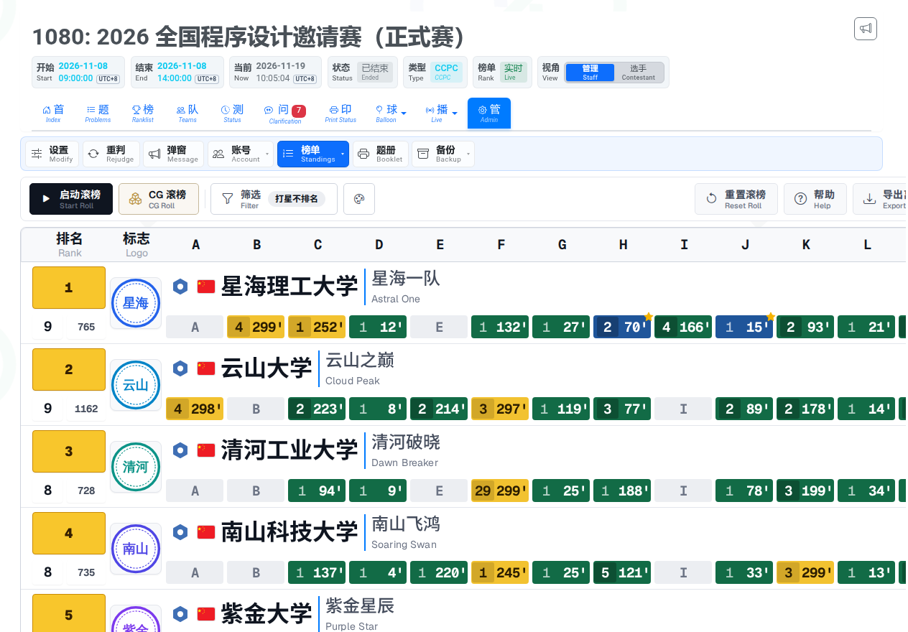

两种滚榜模式共享同一份数据、同一套奖牌计算规则与相同的现场全屏获奖信息浮层。点击**启动滚榜**进入经典卡片舞台，先铺开深色开场幕布，进入全屏榜单后平滑纵览到末位起始位置，再自下而上逐题揭晓封榜提交，过题队升入新名次后立即定位下一待处理队伍。

点击 **CG 滚榜** 进入暗曜石大屏三维舞台，演播按四幕推进：

1. **赛事序幕**：展示参赛队伍数、院校数、赛题数、封榜时长与各档奖线，按 **`N`** 进入下一幕或按 **`F`** 跳至奖区。
2. **全场提交回放与巡礼**：按时间顺序用三维光弧回放封榜前提交，封榜后提交只落为待揭晓 `?` 状态，随后镜头从榜首巡礼至待揭晓起点（按 **`N`** 加速回放，再按 **`N`** 直接定格起点）。
3. **三维翻牌揭晓与升榜**：锁定待揭晓题格时，左下角在不剧透结果的前提下推算「若过题最高可达名次与奖区」；翻牌揭晓后过题队伍稳速升入新名次，跨屏冲榜队伍由右侧播报 `#原名次 → #新名次`。
4. **冠亚季军领奖台谢幕**：全场揭晓完毕后自动展示「亚军 · 冠军 · 季军」领奖台，支持鼠标滚轮自由上下检视三维终榜，按 **`Esc`** 退出。


无封榜待揭晓题时按下一步进入全屏获奖信息浮层（未上传队伍照片时自动显示纯平奖章舞台）；配置了多个赛事归属且同时在筛选区选中多组别时，奖区徽章与各归属奖项牌匾会分色高亮标示所属组别，底部统计区仍清晰列明该队的全场总排名、解题数与首答记录。

**滚榜通用操控快捷键**：

| 操作 | 按键 / 鼠标动作 | 说明 |
| --- | --- | --- |
| 前进一步 | `N`、`空格`、`Enter`、`↑`、`→`、左键单击 | 顺次锁定下一题 → 翻牌揭晓 → 排序升榜 → 打开或关闭获奖全屏页 |
| 跳到下一奖区 | `F`、鼠标右键 | 直接滚动并自动揭晓至目标奖区前一名边界（多归属选多个组时按边界交叉依次停靠）；向奖区滚动过程中按任意键仅会加速完成当前这一跳，到达站稳后再按 `F` 才跳往下一奖区 |
| 自动滚榜 | `A` | 自动匀速推进；首次进入获奖区域时会自动停下交回主持人掌控节奏，再次按 `A` 后不再自动暂停 |
| 撤回上一步 | `U`、`↓`、`←`、`Backspace` | 即时平滑撤回上一步揭晓与升榜（含正开启的获奖页），为防翻页笔误触须在 1.5 秒内连续按两次确认 |
| 向前快进 10 队 | `G` | 跳过 10 支队伍（同样须 1.5 秒内双击确认） |
| 向后回退 10 队 | `I` | 回退 10 支队伍（同样须 1.5 秒内双击确认） |
| CG 舞台专属键 | `C` / `M` / `H` / `V` | 分别对应切换三种导播视角机位、开关内置合成音效、显隐舞台四周辅助面板、重播开场提交回放 |
| 退出全屏 | `Esc` | 退出滚榜全屏演示并停驻于当前进度 |

正式开始滚榜前应完成两项准备工作：

1. **队伍照片管理**：点击工具栏「队伍照片」（或后台「管 → 榜单 → 队伍图片」），可单张上传或以队伍登录账号命名（如 `team001.webp` 或 `team001.jpg`）进行批量上传；照片建议接近 **4:3** 横构图、人物尽量居中、分辨率不低于 `1440×1080`，系统会在保证人物头部的基础上自动裁剪压缩。
2. **缩放核对与离线包**：全屏滚榜打开后，可通过 **`Ctrl + 鼠标滚轮`** 或 **`Ctrl + +/-`** 将页面调节至现场大屏一屏约显示 12 支队伍、且各项罚时与题号数字无省略号截断为宜。如果闭幕式舞台所在电脑断网或到机房服务器网络不稳定，在页面点击「导出离线包」，下载生成的单文件压缩包拷贝至现场电脑解压打开浏览器即可离线进行经典滚榜或三维 CG 滚榜（建议仍用实机预演完整走一遍）。

## 8. 检查清单

### 赛前核对

- [ ] 比赛大类为**标准赛**（ICPC / CCPC），状态已改回**公开**，「开始 / 结束 / 封榜两格 / 获奖基数」均已逐项核对
- [ ] 「获奖方案」与「队伍赛事归属配置」中的金银铜比例或人数、是否含打星及各项专项奖参数已保存一致
- [ ] CCPC 场次的「题号公开」阈值与「气球乱序」开关符合现场规则
- [ ] 所有题目、多语言题面、附件插图、PDF 题面与五类评测题型均已实测通过；特判、交互、通信、多进程文件名严格为 `tpj.cc`
- [ ] 如现场印刷纸质题册，已从「题册」完成多语言核查与另存 PDF 校样
- [ ] 如需机位抽签，双方持有相同清单与抽签种子且可复现；队伍账号、秘密生成的密码密钥及可裁切密码条已导出保管
- [ ] `printer`、`balloon_manager`、`balloon_sender`、`watcher`、`reviewer` 与比赛内 `admin` 账号已分发就位且范围/分区绑定无误
- [ ] 使用终端交题与送印的赛场，选手机已完成 `csgsubmit` 与 `printfile` 预置，抽检 `csgsubmit info` 准确且所有机器已在「客户端管理」录入 IP（确认收集模式已在赛前关闭）
- [ ] 打印机默认驱动与示例页/示例小票、现场大屏、OBS 导播画面及网络（或热备从机与独立外榜）均已实机通测

### 赛中核对

- [ ] 如队伍换座或机器异常，及时通过「队伍状态」解锁 IP 或配置「特判结束时间」单队延时
- [ ] 代码打印服务连接正常，纸张余量充足，异常卡单及时释放或重打
- [ ] 气球任务产生、分配、配送员手机状态标记及到达封榜后自动停打符合现场预期
- [ ] 实时榜单、独立外榜推送间隔、直播控制台节目画面及投屏客户端状态保持同步且无异常积压评测队列

### 赛后核对

- [ ] 评测状态页面无任何等待或评测中的提交，重新核算刷新后导出最终获奖名单
- [ ] 「颁奖编排」全屏宣读、离线网页或 PowerPoint 成品已导出并在闭幕式播放电脑试放过一遍
- [ ] 队伍照片已批量上传且经预览裁剪无误，滚榜缩放比例调校完成；如现场需离线播放，已在投屏主机实机验证离线滚榜包双模式运转顺畅

### 现场易错提醒

- 特判、交互、通信与多进程题的协议源码文件名必须严格使用 `tpj.cc`，修改测例压缩包内文件名大小写勿重复混用。
- 队伍生成页面填写的 16 位以上密码密钥务必妥善留存且不要外传；导出密码条后管理员自留一套电子或纸质备查副本。
- 气球配送员使用手机系统自带浏览器访问赛站登录 `balloon_sender`，不要在微信、QQ 等应用内置浏览器内打开页面。
- CCPC 未揭示题目阶段，不要看公开榜或按题号字母顺序拿气球；务必以气球队列大字字母或气球总览格圆标为准。
- 启动热备从机前确认主从两台服务器的系统时区完全一致。
- 闭幕式滚榜与颁奖 PPT 在正式仪式开始前务必连同现场投影仪按实战分辨率完整预演一次。
