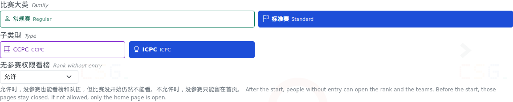
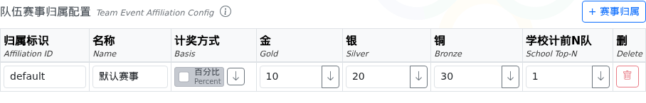
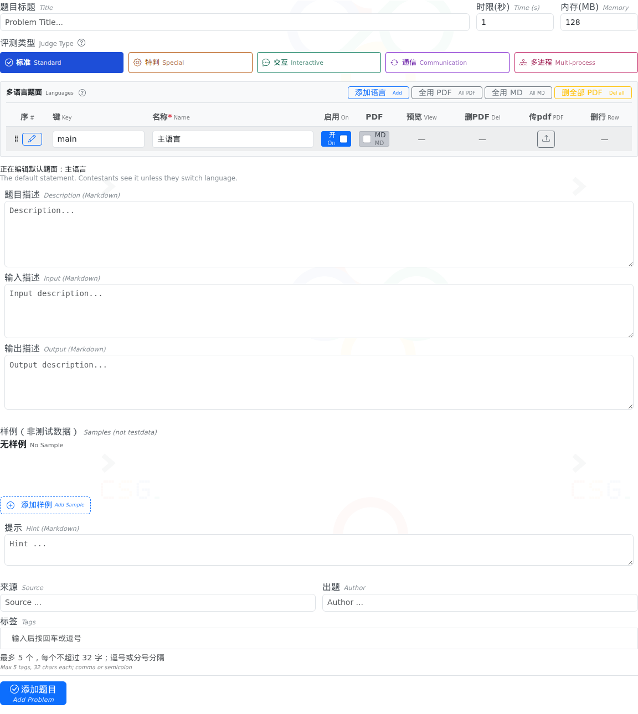
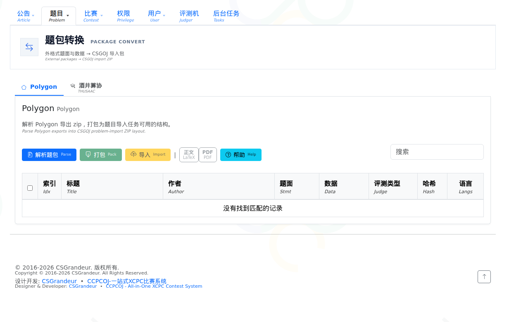
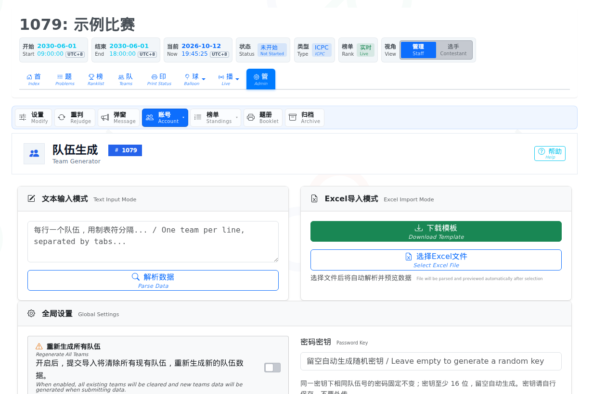
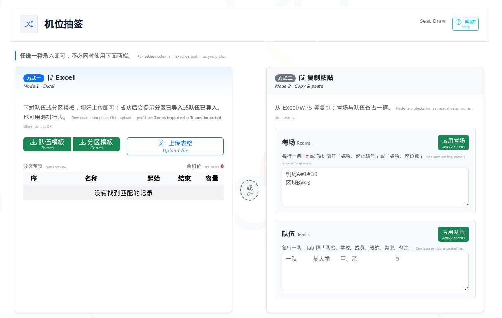
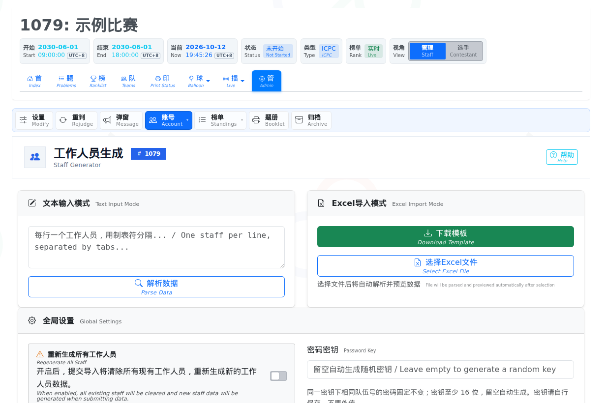

# 组织一场 XCPC 标准赛

用 CCPCOJ 办 ICPC 或 CCPC：建比赛、放题目、生成账号、抽机位、打印、气球、榜单、直播和滚榜。

## 目录

- [1. 赛前、赛中、赛后](#1-赛前赛中赛后)
- [2. 谁登录、从哪进](#2-谁登录从哪进)
- [3. 赛前](#3-赛前)
- [4. 赛中](#4-赛中)
- [5. 赛后](#5-赛后)
- [6. 检查清单](#6-检查清单)

## 1. 赛前、赛中、赛后

| 阶段 | 要做的事 |
| --- | --- |
| 赛前 | 建比赛、导入题目、生成队伍和工作人员、抽机位、打密码条 |
| 赛中 | 打印、气球、大屏、直播 |
| 赛后 | 导出获奖、滚榜；现场上不了网时用离线包 |

正式赛前至少走一遍：题目能评测，队伍能登录，抽签结果能用同一个种子复现，打印员、气球员和直播账号能登录，大屏和滚榜能打开。

## 2. 谁登录、从哪进

系统管理员：在左侧菜单的空白处快速连点三下，弹出管理员登录。比赛里的队伍和工作人员：进入该场比赛后，在公告区域登录。

比赛页顶栏的开始、结束和当前时间，按浏览器所在时区显示，旁边有时区简写。鼠标放在开始或结束时间上，可以看到创建比赛时填写的时间。

有新公告时，页面换成新内容，并提示未读。

| 角色 | 用来做什么 |
| --- | --- |
| 系统管理员 | 建比赛、导题、生成账号、导出数据 |
| 队伍 | 参赛登录 |
| printer | 处理打印 |
| balloon_manager | 看气球任务，必要时分配或撤销 |
| balloon_sender | 领取并送出气球 |
| watcher | 做直播叠加画面 |
| reviewer | 审阅。不进榜，也没有赛务管理权限 |
| 比赛内的管理员 | 现场监管、闭幕式滚榜 |

比赛页可以把视角从「管理」切到「选手」。选手一侧的题集、榜和评测状态，与参赛队自己打开时相同。

## 3. 赛前

### 3.1 创建比赛

管理后台 → 比赛 → 添加比赛。

办 XCPC 时，比赛大类选**标准赛**，子类型选 **ICPC** 或 **CCPC**。标准赛的队伍账号在这场比赛里生成。



- **ICPC**：开赛起，题号按字母公开。
- **CCPC**：公开榜上先出现过题的格子，这一题通过的队伍达到揭示条件后，格子才带字母。参赛队在题集里仍能看到全部题目。未揭示的题，别人的提交里没有题号。

「无参赛权限看榜」缺省是允许：没登录，或登录了但没有这场的参赛权限，开赛之后仍可看榜和队伍。比赛还没开始时，这两页打不开。改成不允许后，没有参赛权限的人只能留在首页。

计奖写在「队伍赛事归属」里。只有一个归属时，用默认那一行即可。超过一个归属时，榜单上才会按归属筛选。



计奖方式关掉是百分比：金、银、铜各填 0 到 100，三者相加不超过 100。打开是固定名额，填的就是人数。学校计前 N 队，是学校排名用各校前几支队伍。一行末尾的下箭头，把这一格的值抄到下面每一行。

封榜有两格。距结束：结束前最后这些分钟里榜单冻结，填 0 表示不封。结束后：比赛结束后还要再冻这么多分钟，填 0 表示一结束就解开。


**获奖基数**在添加比赛时选，之后改比赛类型不会改变它。内榜、外榜、直播、颁奖编排和获奖信息都用这一项算金银铜名额。

- **过题为基数**：只算至少通过一题的正式队。新建 ICPC 默认是这项。
- **交题为基数**：交过题的正式队都算，包括只有编译错误、没有形成榜上提交的队。新建 CCPC 默认是这项。
- **全部为基数**：正式队都算，没交过题的也算。

**锁定登录 IP** 默认关闭。打开后，选手不能换一台机器再登录，要在后台「账号 → 队伍状态」里解锁。工作人员账号不锁。无论是否锁定，队伍登录都会记下 IP。

新建的比赛默认不公开。在比赛列表里把它改成公开，队伍才能进入。否则登录会提示进不了这场比赛。

### 3.2 题目

题面用 Markdown，公式用 LaTeX。管理后台 → 题目 → 添加题目。

评测类型选标准、特判、交互、通信或多进程。悬停可以看这一类怎么跑、要不要协议程序。点问号打开说明。特判、交互、通信、多进程会在本页出现协议程序编辑区，保存题目后才会提交到服务器。

同一题可以有多份语言的题面。排在最上的一份是默认题面，选手不切换语言时看到这一份。语言可以单独关掉：数据还在，选手端不再看到。需要 PDF 时，先保存题目，再上传 PDF。



图片放在题目附件里。先保存题目，打开附件，上传后把相对路径贴进题面。某一段要按 LaTeX 排版时，在该段开头单独写一行 `__LATEX__`。

#### 特判

自定义判题时，把判定程序和评测数据一起上传，并勾选特判。判定程序用 testlib，文件名必须是 `tpj.cc`。评测机会编译它。结果只有通过和答案错误。系统不接受 `spj.cc`。

浮点误差示例：

```cpp
#include "testlib.h"
#include <cmath>

const double eps = 1e-6;

int main(int argc, char* argv[]) {
    registerTestlibCmd(argc, argv);
    while (!ans.seekEof()) {
        double expected = ans.readDouble();
        double actual = ouf.readDouble();
        if (std::fabs(expected - actual) > eps) {
            quitf(_wa, "expected %.6f but found %.6f", expected, actual);
        }
    }
    quitf(_ok, "accepted");
}
```

测例文件是 `.in` 和 `.out`。上传和导入时，扩展名里的大写会收成小写。同一批里不能同时有 `1.in` 和 `1.IN`。标准评测里每个输入都要有同名输出。答案文件的大小上限是评测设置里的「最大输出限制」。

交互、通信、多进程的协议也写在 `tpj.cc`。通信题要选第二轮怎么比；多进程题要填选手进程数。页面上可以下载本机调试工具，在自己的电脑上对样例。是否通过，以提交后的评测结果为准。

### 3.3 从 Polygon 导入

管理后台 → 题目 → 题包转换。打开 Polygon，上传导出的 zip，点解析题包。解析完成前，打包和导入不能点。点帮助可以看目录要求。核对评测类型后，再打包或导入。



在 macOS 上用系统自带的压缩时，包里可能带有系统附加目录。解析时会跳过，一般不用先手工删掉。

### 3.4 队伍账号

在比赛页点「管」，再点「账号」里的队伍生成。可以用文本，一行一支队伍，列与列之间用制表符；也可以下载 Excel 模板再导入。按 Tab 会插入制表符。



密码密钥至少 16 位。同一密钥、同一队伍号，密码不变。留空会自动生成一串密钥，请自己保存，不要外传。已经生成的账号，密码不会因为后来改了密钥而改变。

勾选「重新生成所有队伍」后，这次导入会换掉现有队伍。表格没通过检查时，原来的队伍不动。这次清空不会删掉工作人员。

导入后，在表格右上角下载打印表。里面有可裁开的密码条、不同排版，以及可归档的账号表。打印后按单位、队伍或座位排好。管理员自己留一份，现场丢了能补。

不需要现场抽签、名单已经定好时，直接按模板导入即可。

### 3.5 机位抽签

工具集 → 机位抽签。只要抽签结果、先不导入比赛时，可以不登录直接用。

Excel 和复制粘贴任选一种。房间和队伍可以混在一张表里。抽完后按单位序或队号序导出。



承办方和管理员各留一份相同的房间和队伍表。承办方在开幕式抽签，把页面上的随机种子发给管理员。管理员用同一份表、同一个种子复现，再把结果导入比赛。热身赛前先模拟一次。

### 3.6 工作人员

在同一场比赛的「账号」里打开工作人员生成。先准备打印员、气球员的名单。`balloon_sender` 每人一个账号，方便对任务。`reviewer` 是审阅账号，不进榜。



页面上可以先出模板，再拷到 Excel 里改。勾选重新生成后，审阅账号和其他工作人员一起被换掉。

另外准备两个比赛内的管理员：一个现场用，一个赛后滚榜用。赛前把账号交给承办方，再发给对应的人。

### 3.7 队伍状态

比赛开始后，在「账号」里打开队伍状态。能看到每队的队号、队名、学校、房间、成员、教练和登录 IP，页顶有总队数、已登录数，以及各状态的队数。

打开了锁定登录 IP 的比赛，可以在这里解除某一队的锁定。标准赛（ICPC / CCPC）还可以把某队设为**结束**或**禁赛**：马上不能看题、不能提交，页面上有说明；改回**正常**后马上可以再交。

## 4. 赛中

### 4.1 打印

用一台接着打印机的 Windows 电脑，把目标打印机设成系统默认。打印员打开对应比赛，用 printer 账号登录。多台打印机时，每台对应一台电脑、一个 printer 账号，并分好区域。

比赛刚开始先用手动能印通，再开自动。看完页面上的提示：浏览器、默认打印机和权限都要对。

### 4.2 气球

气球管理员看全局。在气球管理界面按 **A** 切换模式。

分配模式用来核对。配送员领取、标完成，都会出现在这里。需要时点开一个任务，分给指定的 balloon_sender。

标记模式适合用纸条或在线表格集中派发。点任务就标成已下达。这个模式可以不依赖配送员账号。

配送员用手机连赛场 Wi-Fi，用系统自带浏览器打开比赛站，登录自己的 balloon_sender。不要用微信或 QQ 里的浏览器。送到后双击任务，标成已发放。要退回任务，双击还没发的气球的时间列。

**CCPC 场**默认打开气球乱序，也可以在比赛设置里关掉。打开时，气球员和配送员看到的大字是要发的气球字母，旁边小字是真实题号；同一支队伍的题和气球一一对应，不会两题发成同一个气球。颜色仍来自题目设置里的那一组颜色，只是不再跟真实题号绑在一起。关掉后按原来的题号发。不要到公开题集或榜单上找气球颜色来发气球。

给 printer、balloon_manager、balloon_sender 填了房间或分组后，对应页面会锁在这个范围里。

### 4.3 大屏

可以用外榜，也可以在榜单页打开动态榜。

| 操作 | 按键 |
| --- | --- |
| 自动刷新 | `A` |
| 自动滚屏 | `B` |
| 浏览器全屏 | `F11` |

赛前看一遍：队名和题目列能完整显示，刷新和滚屏正常，内外网访问和现场网络一致。

榜单和外榜的「筛选」可以按学校、队伍挑出关心的队，结果置顶、只显示或高亮，名次不变。「高级」页可以写规则：一段正则加要匹配的字段（队名、学校、队员、教练、考场、分组等），多条规则选「任一满足」或「全部满足」，例如学校填 `^浙江`。规则只存在本机浏览器，可以复制成文本发给别人导入。

### 4.4 直播

用 watcher 登录比赛，从菜单进入直播。配好要展示的内容和开关，打开叠加层，拿到链接。在 OBS Studio 里加一个浏览器来源，把链接填进去。

## 5. 赛后

### 5.1 获奖

比赛结束后，等评测状态里没有未判完的提交，刷新获奖页，再导出。承办方用这张表做证书、奖牌和新闻稿。

金银铜按比赛设置里的获奖基数计算（过题 / 交题 / 全部正式队），不在这一页改。奖项分为按归属和全场合算两种，见 3.1。顽强拼搏按该队各题第一次过题里最晚的一次计算，同一题再过不计。

### 5.2 滚榜

闭幕式一般由承办方用比赛内的管理员操作。打开比赛，登录，进入滚榜，全屏后开始。

队伍照片可以单张上传，也可以批量上传。批量时文件名用比赛账号，例如 `team001.jpg`。照片宽高比用 3:2。差得多就不要传，差一点会被裁。滚榜电脑到服务器的网络不稳时，提前完整滚一遍，让浏览器把照片留下。

全屏后可以用 `Ctrl` 加滚轮，或 `Ctrl` 加 `+` / `-` 缩放。屏幕上大约同时显示 12 支队伍。数字要完整，不要出现省略号。

现场访问不了服务器时，用滚榜页上的打包下载，把数据拷到现场电脑再打开。

## 6. 检查清单

### 赛前

- [ ] 比赛大类是标准赛，子类型是 ICPC 或 CCPC
- [ ] 比赛已公开，时间和封榜的两格已确认
- [ ] 获奖基数（过题 / 交题 / 全部）已确认；金银铜是百分比或固定名额，学校计前 N 队已确认
- [ ] 题面、样例、图片能显示；普通题和特判都测过
- [ ] 特判文件名是 `tpj.cc`
- [ ] CCPC 的气球乱序开关按现场需要设置（默认开）
- [ ] 队伍能登录；密码密钥已另行保存；锁定登录 IP 按需要设置
- [ ] 抽签用过同一份表和同一个种子复现
- [ ] 密码条已打印，管理员留有一份
- [ ] 打印员、气球员、直播、审阅和比赛管理员账号已生成
- [ ] 大屏、打印机、OBS 和现场网络试过

### 赛中

- [ ] 打印页能收到任务，默认打印机可用
- [ ] 气球能生成、领取、完成或退回
- [ ] 榜单能刷新，直播叠加层正常
- [ ] 评测队列没有异常堆积

### 赛后

- [ ] 没有未判完的提交，获奖表已导出
- [ ] 滚榜账号能登录，照片已上传
- [ ] 需要离线滚榜的，已在现场电脑试过

### 容易出错的地方

- 协议程序文件名是 `tpj.cc`，不要传 `spj.cc`
- 承办方和管理员抽签必须用同一份表、同一个种子
- 密码密钥不要外传；密码条打印后留一份备查
- 气球员用手机自带浏览器，不用微信或 QQ 内置浏览器
- 滚榜前完整预演一次：照片、缩放、大屏
